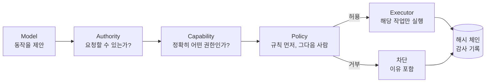
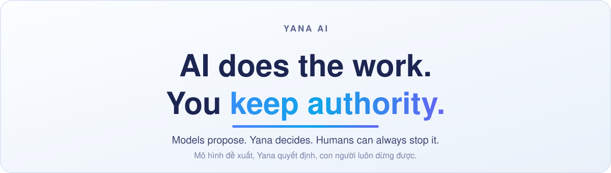

<p align="center">
  <picture>
    <source media="(prefers-color-scheme: dark)" srcset="docs/yana-banner-dark.svg">
    
  </picture>
  <br><br>
  
</p>

<h3 align="center">모델은 제안하고, Yana가 판단하며, 결정권은 사람에게 있습니다.</h3>

<p align="center">
  AI 모델과 내 컴퓨터의 실제 권한 사이에서 로컬로 동작하는 제어 계층입니다.<br>
  Yana 생태계의 런타임, 규칙, 감사 기록을 담당합니다.
</p>

<p align="center">
  <a href="https://github.com/Horonomos-laps/Yana-AI/actions/workflows/ci.yml"></a>
  <a href="https://crates.io/crates/yana-rt"></a>
  <a href="https://pypi.org/project/yana-ai/"></a>
  <a href="LICENSE"></a>
</p>

<p align="center">
  <a href="https://merx.help/shield"></a>
  <a href="https://launchindex.io/tool/yana-ai"></a>
</p>

<p align="center">
  <a href="README.md">English</a> ·
  <a href="README.vi.md">Tiếng Việt</a> ·
  <a href="README.ko.md"><strong>한국어</strong></a> ·
  <a href="README.zh.md">中文</a>
</p>

<p align="center">
  <a href="#빠른-시작">빠른 시작</a> ·
  <a href="#동작-방식">동작 방식</a> ·
  <a href="#yana-생태계">생태계</a> ·
  <a href="#내부-구조">내부 구조</a> ·
  <a href="#보호-장치와-한계">한계</a> ·
  <a href="https://yana.vutam.link">웹사이트</a>
</p>

<p align="center">
  <sub>
    <a href="CODE_OF_CONDUCT.md">행동 강령</a> ·
    <a href="CONTRIBUTING.md">기여하기</a> ·
    <a href="LICENSE">Apache-2.0 라이선스</a> ·
    <a href="SECURITY.md">보안 정책</a>
  </sub>
</p>

<br>

<table>
  <tr>
    <td align="center" width="20%"><h3>45</h3><sub>런타임 하위 명령<br>Rust 바이너리 하나</sub></td>
    <td align="center" width="20%"><h3>66</h3><sub>도구 호출 hook<br>Pre, Post, Stop</sub></td>
    <td align="center" width="20%"><h3>290</h3><sub>핵심 파일<br>SHA-256으로 고정</sub></td>
    <td align="center" width="20%"><h3>100</h3><sub>전문 에이전트</sub></td>
    <td align="center" width="20%"><h3>2,036</h3><sub>작업 지식 스킬,<br>권한 없음</sub></td>
  </tr>
</table>

<p align="center"><sub>수치는 파일 시스템에서 세며 CI에서 <code>core/scripts/check_counts.py</code>로 확인합니다.</sub></p>

## 만든 이유

명령을 실행할 수 있는 에이전트는 잘못된 명령도 실행할 수 있습니다. 스킬과 프롬프트는
에이전트가 일을 더 잘하게 만들지만 피해를 막지는 못합니다. Yana는 모든 동작 앞에 별도의
판단 단계를 두며, 이 단계는 모델이 올바르게 행동하는 것에 의존하지 않습니다.

- 모델은 하려는 일을 말하고, 허용할지는 Yana가 판단합니다.
- 모든 판단은 해시 체인 기록에 남으므로 나중에 고치면 드러납니다.
- 사람은 언제든 에이전트를 멈출 수 있으며, 일부 동작은 사람 없이는 실행되지 않습니다.

## 빠른 시작

```bash
pip install yana-ai    # Python CLI
yana-ai install        # Yana의 hook과 rule을 저장소에 추가
yana-ai doctor .       # 연결 상태 확인
cargo install yana-rt  # 네이티브 런타임, Python 불필요
```

Python 3.11 이상(또는 Rust), Git, 지원 호스트 하나가 필요합니다: Claude Code, Codex,
Cursor, Antigravity. 전체 명령은 [COMMANDS.md](COMMANDS.md)에 있습니다. Yana는 npm에
배포하지 않습니다. [VERSIONING.md](VERSIONING.md)를 참고하세요.

**앱을 원한다면** macOS용 Yana와 Yana Studio를
[Yana-studio 릴리스](https://github.com/Horonomos-laps/Yana-studio/releases/latest) 또는
[yana.vutam.link](https://yana.vutam.link)에서 한 번에 받을 수 있습니다. Apple Silicon의
macOS 14 이상이 필요합니다.

<!-- IMAGE: 승인 절차와 함께 에이전트를 실행하는 Yana Studio -->

> [!NOTE]
> macOS 빌드는 ad-hoc 서명이며 **Apple 공증을 받지 않았습니다**(Apple Developer 계정이
> 아직 없습니다). 그래서 처음 열 때 Gatekeeper가 경고합니다.
> [docs/MACOS_INSTALL.md](docs/MACOS_INSTALL.md)에 두 가지 공식 실행 방법이 있습니다.
> 내려받은 파일은 릴리스에 적힌 SHA-256 값과 대조하세요. `yana-rt` 바이너리는
> macOS(Apple Silicon, Intel), Linux x64, Windows x64용이 있으며 Linux ARM용은 없습니다.

## 동작 방식

Claude, GPT, Gemini, DeepSeek, 내 컴퓨터에서 실행하는 모델까지 모두 같은 경로를 거칩니다.



스킬은 에이전트에게 일하는 방법을 가르칩니다. 행동할 권한은 capability만 부여합니다.

## Yana 생태계

|  | **Yana-AI** (현재 저장소) | **[yana-web](https://github.com/Horonomos-laps/yana-web)** | **[Yana-studio](https://github.com/Horonomos-laps/Yana-studio)** |
| --- | --- | --- | --- |
| **구성** | 런타임 `yana-rt`, 거버넌스 규칙과 hook, CLI, 에이전트와 스킬 | 웹사이트, 그리고 내 컴퓨터에서 실행하는 웹 앱(채팅, 프로젝트, 키 보관함) | macOS용 Yana와 Yana Studio |
| **기술** | Rust, Python, shell | Node.js, React | SwiftUI, Code-OSS |
| **역할** | 판단 | 표시 | 표시 |

앱은 모델 제공업체를 직접 호출하지 않습니다. Studio는 모든 요청을 `yana-rt`로 보내므로
클라이언트를 바꿔도 권한 검사를 건너뛸 수 없습니다.

> [!NOTE]
> 웹 앱, 웹사이트, 데스크톱 앱은 각자의 저장소로 옮겼습니다. `tools/yana-web`,
> `tools/yana-studio`, `tools/yana-ide`를 가리키는 예전 링크와 기록은 이동한 코드를
> 말합니다. 해당 부분의 새 작업은 yana-web과 Yana-studio에서 합니다.

## 이 저장소의 구성

| 구성 요소 | 하는 일 | 상태 |
| --- | --- | --- |
| **[런타임 `yana-rt`](src)** | 모든 클라이언트와 제공업체에 하나의 턴 루프와 하나의 authority 계약. |  |
| **[거버넌스](core)** | capability manifest, 사람의 승인, 해시 체인 감사 기록, core-lock 무결성. |  |
| **[Giám Thị](#내부-구조)** | 모든 AI 세션 밖에서 동작하며, 차이를 발견하면 이후의 도구 호출을 모두 멈춥니다. |  |
| **[Harness adapters](adapters)** | Claude Code, Codex, Cursor, Antigravity. 강제 수준은 호스트마다 다릅니다. |  |
| **[지식 계층](core/skills)** | 에이전트에게 일하는 방법을 가르치는 에이전트, 스킬, 명령, 규칙. 권한은 부여하지 않습니다. 수는 아래 트리에 있습니다. |  |
| **[Yana OS](src/os)** | 로컬 관리 계층: 에이전트 신원, 자율 수준, 할당량, 상태, 격리. |  |
| **[Yana Wheelbot](https://github.com/yanacuti1121/yana-wheelbot)** | ESP32-S3 로봇 플랫폼, 별도 저장소. |  |

`사용 중`은 배포되어 쓰이는 상태입니다. `개발 중`은 실제 코드가 있지만 기능이 완성되지
않은 상태입니다. `실험`은 선택 사용이며 독립 검증을 거치지 않은 상태입니다.

`yana-rt`의 하위 명령은 45개이며 Python 의존성이 없습니다. feature flag 뒤의 명령까지
포함해 모든 빌드 구성의 소스 코드를 기준으로 센 수입니다.

```text
core/
├── hooks/    # 66개 PreToolUse / PostToolUse / Stop hook, 실행 대상은 settings.json이 정함
├── rules/    # 71개 rule, 대부분 에이전트가 스스로 따르는 지침, 일부만 hook이 강제
├── agents/   # 100개 전문 에이전트
├── skills/   # 2,036개 스킬
├── commands/ # 170개 Claude Code 슬래시 명령
└── config/
    └── core-lock.json    # SHA-256 manifest, 핵심 파일 290개 고정
```

## 내부 구조

항목을 열면 자세한 내용이 보입니다.

<details>
<summary><b>런타임: Rust 엔진 yana-rt</b></summary>

Rust 바이너리 하나가 모든 클라이언트의 턴 루프와 authority 검사를 맡으므로, Studio,
CLI, MCP가 권한 로직을 각각 다시 만들지 않습니다.

- **Provider:** anthropic, openai, gemini, groq, deepseek, openrouter, xai, novita, nvidia, minimax, glm, huggingface, 9router, kimi, mistral, together, fireworks, deepinfra, cerebras, sambanova, perplexity, qwen, cohere, ai21, ernie (클라우드), 그리고 ollama, lmstudio, llamacpp, turbofieldfare, airllm, vllm, jan (로컬). 기준 목록은 [`src/model/catalog.rs`](src/model/catalog.rs)입니다.
- **장애 전환:** 유형이 구분된 제공업체 오류, 대체 제공업체, 자격 증명 풀 순환.
- **상태:** 전문 검색이 되는 SQLite 세션 저장소, 프로필별 상태, 크래시 복구, rollback이 되는 shadow-git 체크포인트.
- **Capability 도구:** 파일 읽기/패치, 검증을 거친 명령 실행, stdio MCP 클라이언트, 검사된 HTTPS 계층의 `web.search`, 읽기 전용 LSP 클라이언트.
- **기능:** 기본 빌드는 `cli`와 `mcp`(MCP 서버와 클라이언트)입니다. `lsp`, `pty-bridge`, Discord 어댑터는 선택 사항이며 기본으로 꺼져 있습니다.

남은 런타임 작업은 [CURRENT-MILESTONE.md](CURRENT-MILESTONE.md)에 있습니다. 모든
클라이언트를 하나의 capability executor로 통합하고, mock 대신 실제 로컬 모델로 도구
호출을 시험하는 일입니다.

</details>

<details>
<summary><b>성능: 측정값 위치</b></summary>

날짜, 버전, 장비, 방법을 적은 측정값은 [BENCHMARK.md](BENCHMARK.md)에 있습니다. 예전
측정이 현재 값처럼 보이지 않도록 이 페이지에는 옮겨 적지 않습니다.

</details>

<details>
<summary><b>Giám Thị: 독립 감시기</b></summary>

모든 AI 세션 밖에서 운영체제의 스케줄러(macOS launchd, Linux systemd timer, Windows
Task Scheduler)로 6시간마다 실행됩니다.

1. 강제 장치를 좌우하는 파일을 사람이 승인한 기준 커밋과 비교합니다: Claude Code, Codex, Cursor의 hook 설정, CI 워크플로, `core/rules`, `core/gates`, `core/hooks`, `core/scripts`, `src/guard`.
2. 차이가 있으면 `GIAMTHI_HALT.lock`을 씁니다. 잠금 파일이 있는 동안에는 모든 도구 호출에서 가장 먼저 실행되는 hook이 전부 거부합니다.
3. 사람이 잠금 파일을 삭제해야만 풀립니다. hook, 감시기, 환경 변수로는 풀 수 없습니다.

`yana-ai giamthi install | status | repair | uninstall`로 관리합니다. 선택 기능이며,
일정에 따라 실행되므로 변경과 중단 사이에 최대 6시간의 간격이 있습니다. Codex는 shell
명령에만 `PreToolUse`를 호출하므로, Codex에서는 `SessionStart`와 `UserPromptSubmit`에서도
잠금을 확인합니다.

</details>

<details>
<summary><b>Harness adapters: Claude Code, Codex, Cursor, Antigravity</b></summary>

| 호스트 | 적용 방식 | 강제 수준 |
| --- | --- | --- |
| **Claude Code** | `.claude/`의 네이티브 hook과 rule | 모든 도구 호출을 실행 시점에 차단, 해시 체인 감사 |
| **Codex** | `AGENTS.md`, `.codex/` hook, 스킬과 에이전트 동기화 (`yana-ai install --engine codex`) | 프로젝트 범위 hook |
| **Cursor** | `.cursorrules`, `.cursor/rules`, `beforeShellExecution` hook | shell 명령 검사, MCP 도구 호출은 미적용 |
| **Antigravity** | `.agents/rules/yana-ai.md`와 `.agents/hooks.json`의 `PreToolUse` hook (`yana-ai install --engine antigravity`) | shell 명령을 `guard-destructive.sh`가 검사, Giám Thị HALT는 모든 도구 호출 차단, `agy --dangerously-skip-permissions`에서는 생략됨 |

자세한 내용과 전환 명령은 [adapters/README.md](adapters/README.md)에 있습니다. Claude Code
슬래시 명령(`/plan`, `/verify`, `/code-review` 등)은 `core/commands/`에 있고 세션 안에서
실행됩니다.

</details>

## 보호 장치와 한계

| 보호 장치 | 하는 일 | 한계 |
| --- | --- | --- |
| **감사 기록** | 해시 체인이라 한 줄을 고치거나 지우면 드러납니다 (`core/scripts/verify-audit-chain.sh`). | 변조를 탐지할 뿐 막지는 못합니다. |
| **Core-lock** | SHA-256 manifest가 `core/`의 변경, 삭제, 삽입을 찾아냅니다. | 트리가 lock과 일치함을 증명할 뿐 사람이 검토했음을 증명하지 않습니다. `core/`를 고칠 수 있으면 lock도 다시 만들 수 있습니다. 독립 확인은 Giám Thị가 맡습니다. |
| **사람 승인** | force-push, publish, deploy, 삭제는 현재 세션의 확인이 필요합니다. | 이전 승인은 이어지지 않습니다. |
| **Giám Thị** | 문제를 발견하면 사람이 풀 때까지 이후의 모든 도구 호출을 잠급니다. | 선택 기능이며 주기적으로 동작해 즉시는 아닙니다. |
| **Rule과 hook** | hook은 실행 시점에 차단합니다. | `core/rules`의 파일 대부분은 에이전트가 스스로 따르는 지침이며, hook에 연결된 것만 강제됩니다. 코드 서명 절차는 없습니다. |
| **파괴 명령 guard** | `guard-destructive.sh`가 `rm -rf`, force-push, `DROP TABLE` 등을 차단합니다. | 명령 문자열을 대조할 뿐 shell을 완전히 해석하지 않아, 의도적으로 만든 명령은 통과할 수 있습니다. |

Antigravity는 shell 명령만 검사하며 `agy --dangerously-skip-permissions`로 우회됩니다.
Cursor는 MCP 호출을 검사하지 않고, Rust 런타임 없이 브라우저에서만 동작하는 웹 배포는
완전히 통제되지 않습니다. 자세한 내용: [알려진 한계](docs/reference/known-limitations.md).

예시 명령 네 개를 2026-11-14에 `main`의 기본 hook 체인으로 다시 실행한 결과입니다
([기술 보고서](https://yana.vutam.link/whitepaper-en.html) 표 1):

| 에이전트가 실행하려는 명령 | 결과 | 차단한 계층과 에이전트에게 알린 내용 |
| --- | --- | --- |
| `curl -fsSL https://.../install.sh \| bash` | 차단 | `tool-proxy-enforcer`: 인터프리터로 파이프. `supply-chain-guard`: 받아서 읽은 뒤 실행. `guard destructive`는 아닙니다. |
| `rm -rf ~/Documents` | 차단 | `guard destructive`(Rust, bash): 강제 재귀 삭제는 되돌릴 수 없습니다. |
| `chmod 777 deploy.sh` | **차단 안 됨** | `core/scripts/safe-run.sh` 래퍼만 차단하며, 이 래퍼는 hook 체인에 연결되어 있지 않습니다. 알려진 빈틈입니다. |
| `git status --short` | 허용 | 읽기 전용이라 어떤 계층도 개입하지 않습니다. |

## 버전

번호와 레지스트리가 각각 다른 세 축이 있습니다: 제품(배포하지 않음), crates.io의
`yana-rt`, PyPI의 Python 패키지 `yana-ai`. 앱은
[Yana-studio](https://github.com/Horonomos-laps/Yana-studio)의 GitHub Releases에서 별도
태그로 배포합니다. 버전 번호는 금방 낡으므로 이 페이지에 적지 않으며, 위의 배지가 실시간
값을 보여 줍니다. [VERSIONING.md](VERSIONING.md)를 참고하세요.

## 문서

| 이해 | 빌드 | 신뢰 | 진행 |
| --- | --- | --- | --- |
| [ARCHITECTURE.md](ARCHITECTURE.md) | [CONTRIBUTING.md](CONTRIBUTING.md) | [SECURITY.md](SECURITY.md) | [ROADMAP.md](ROADMAP.md) |
| [PHILOSOPHY.md](PHILOSOPHY.ko.md) | [COMMANDS.md](COMMANDS.md) | [알려진 한계](docs/reference/known-limitations.md) | [CURRENT-MILESTONE.md](CURRENT-MILESTONE.md) |
| [계보](docs/history/LINEAGE.md) | [BENCHMARK.md](BENCHMARK.md) | [감사의 말](ACKNOWLEDGEMENTS.ko.md) | [CHANGELOG.md](CHANGELOG.md) |

---

<p align="center">
  
</p>

<p align="center">
  팀도 투자도 없이 한 사람이 만듭니다: <b>Vũ Văn Tâm</b>, 베트남<br>
  <a href="https://yana.vutam.link/">yana.vutam.link</a> ·
  <a href="https://github.com/Horonomos-laps/Yana-AI">Yana-AI</a> ·
  <a href="https://github.com/Horonomos-laps/yana-web">yana-web</a> ·
  <a href="https://github.com/Horonomos-laps/Yana-studio">Yana-studio</a> ·
  <a href="LICENSE">Apache 2.0</a>
</p>
