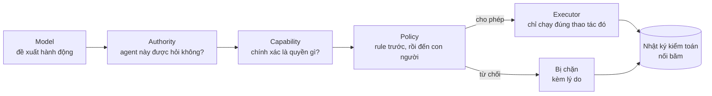

<p align="center">
  <picture>
    <source media="(prefers-color-scheme: dark)" srcset="docs/yana-banner-dark.svg">
    
  </picture>
  <br><br>
  
</p>

<h3 align="center">Model đề xuất. Yana quyết định. Con người nắm quyền.</h3>

<p align="center">
  Lớp điều khiển chạy trên máy bạn, đứng giữa mọi model AI và quyền lực thật trên máy.<br>
  Runtime, rule và nhật ký kiểm toán của hệ sinh thái Yana.
</p>

<p align="center">
  <a href="https://github.com/Horonomos-laps/Yana-AI/actions/workflows/ci.yml"></a>
  <a href="https://crates.io/crates/yana-rt"></a>
  <a href="https://pypi.org/project/yana-ai/"></a>
  <a href="LICENSE"></a>
</p>

<p align="center">
  <a href="https://merx.help/shield"></a>
  <a href="https://launchindex.io/tool/yana-ai"></a>
</p>

<p align="center">
  <a href="README.md">English</a> ·
  <a href="README.vi.md"><strong>Tiếng Việt</strong></a> ·
  <a href="README.ko.md">한국어</a> ·
  <a href="README.zh.md">中文</a>
</p>

<p align="center">
  <a href="#bắt-đầu-nhanh">Bắt đầu nhanh</a> ·
  <a href="#cách-hoạt-động">Cách hoạt động</a> ·
  <a href="#hệ-sinh-thái-yana">Hệ sinh thái</a> ·
  <a href="#bên-trong">Bên trong</a> ·
  <a href="#điều-gì-bảo-vệ-bạn-và-nó-dừng-ở-đâu">Giới hạn</a> ·
  <a href="https://yana.vutam.link">Website</a>
</p>

<p align="center">
  <sub>
    <a href="CODE_OF_CONDUCT.md">Quy tắc ứng xử</a> ·
    <a href="CONTRIBUTING.md">Đóng góp</a> ·
    <a href="LICENSE">Giấy phép Apache-2.0</a> ·
    <a href="SECURITY.md">Chính sách bảo mật</a>
  </sub>
</p>

<br>

<table>
  <tr>
    <td align="center" width="20%"><h3>45</h3><sub>subcommand runtime<br>trong một binary Rust</sub></td>
    <td align="center" width="20%"><h3>66</h3><sub>hook cho tool call<br>Pre, Post và Stop</sub></td>
    <td align="center" width="20%"><h3>290</h3><sub>file lõi<br>được ghim bằng SHA-256</sub></td>
    <td align="center" width="20%"><h3>100</h3><sub>agent chuyên biệt</sub></td>
    <td align="center" width="20%"><h3>2.036</h3><sub>skill kiến thức,<br>không cấp quyền</sub></td>
  </tr>
</table>

<p align="center"><sub>Các con số được đếm từ hệ thống file và được CI kiểm bằng <code>core/scripts/check_counts.py</code>.</sub></p>

## Vì sao có dự án này

Một agent chạy được lệnh thì cũng chạy được lệnh sai. Skill và prompt giúp agent làm việc
tốt hơn, nhưng không ngăn được nó gây thiệt hại. Yana đặt một bước quyết định riêng trước
mọi hành động, và bước đó không phụ thuộc vào việc model cư xử đúng.

- Model nói nó muốn làm gì. Yana quyết định việc đó có được phép không.
- Mọi quyết định được ghi vào nhật ký nối băm, nên sửa về sau sẽ bị phát hiện.
- Con người luôn dừng được agent, và có những hành động không thể diễn ra nếu thiếu con người.

## Bắt đầu nhanh

```bash
pip install yana-ai    # CLI Python
yana-ai install        # thêm hook và rule của Yana vào repo của bạn
yana-ai doctor .       # kiểm tra mọi thứ đã nối đúng chưa
cargo install yana-rt  # runtime native, không cần Python
```

Cần Python 3.11+ (hoặc Rust), Git và một host được hỗ trợ: Claude Code, Codex, Cursor
hoặc Antigravity. Toàn bộ lệnh nằm trong [COMMANDS.md](COMMANDS.md). Yana không phát hành
lên npm, xem [VERSIONING.md](VERSIONING.md).

**Muốn dùng app?** Yana cho macOS và Yana Studio nằm chung một gói tải ở
[trang phát hành Yana-studio](https://github.com/Horonomos-laps/Yana-studio/releases/latest) hoặc
[yana.vutam.link](https://yana.vutam.link). Cần macOS 14 trở lên trên Apple Silicon.

<!-- IMAGE: Yana Studio đang chạy agent có phê duyệt -->

> [!NOTE]
> Bản macOS được ký ad-hoc và **chưa được Apple notarize** (dự án chưa có tài khoản
> Apple Developer), nên Gatekeeper cảnh báo khi mở lần đầu.
> [docs/MACOS_INSTALL.md](docs/MACOS_INSTALL.md) hướng dẫn hai cách chính thức để mở.
> Đối chiếu file tải về với mã SHA-256 ghi trên bản phát hành. Binary `yana-rt` có cho
> macOS (Apple Silicon và Intel), Linux x64 và Windows x64. Chưa có binary Linux ARM.

## Cách hoạt động

Mọi model đều đi cùng một đường: Claude, GPT, Gemini, DeepSeek, hay model chạy ngay trên
máy bạn.



Skill dạy agent cách làm việc. Chỉ capability mới cấp quyền hành động.

## Hệ sinh thái Yana

|  | **Yana-AI** (bạn đang ở đây) | **[yana-web](https://github.com/Horonomos-laps/yana-web)** | **[Yana-studio](https://github.com/Horonomos-laps/Yana-studio)** |
| --- | --- | --- | --- |
| **Là gì** | Runtime `yana-rt`, rule và hook quản trị, CLI, agent và skill | Website, và app web chạy trên máy bạn có chat, dự án và kho khóa | Yana cho macOS và Yana Studio |
| **Công nghệ** | Rust, Python, shell | Node.js, React | SwiftUI, Code-OSS |
| **Vai trò** | Quyết định | Hiển thị | Hiển thị |

Các app không tự gọi provider model. Studio gửi mọi request qua `yana-rt`, nên đổi client
không bỏ qua được bước kiểm tra quyền.

> [!NOTE]
> App web, website và app desktop giờ nằm ở repository riêng. Link cũ và lịch sử nhắc
> `tools/yana-web`, `tools/yana-studio` hay `tools/yana-ide` đang trỏ tới code đã chuyển đi.
> Việc mới ở các phần đó làm tại yana-web và Yana-studio.

## Trong repository này

| Thành phần | Làm gì | Trạng thái |
| --- | --- | --- |
| **[Runtime `yana-rt`](src)** | Một vòng lặp turn và một hợp đồng authority cho mọi client, mọi provider. |  |
| **[Governance](core)** | Capability manifest, phê duyệt của con người, nhật ký kiểm toán nối băm, toàn vẹn core-lock. |  |
| **[Giám Thị](#bên-trong)** | Bộ giám sát chạy ngoài mọi phiên AI, khóa mọi tool call về sau khi phát hiện sai lệch. |  |
| **[Harness adapters](adapters)** | Claude Code, Codex, Cursor và Antigravity. Mức thực thi khác nhau tùy host. |  |
| **[Lớp tri thức](core/skills)** | 100 agent, 2.036 skill, command và rule dạy agent cách làm việc. Chúng không cấp quyền nào. |  |
| **[Yana OS](src/os)** | Lớp quản lý cục bộ: danh tính agent, mức tự chủ, quota, sức khỏe, cách ly. |  |
| **[Yana Wheelbot](https://github.com/yanacuti1121/yana-wheelbot)** | Nền tảng robot trên ESP32-S3, nằm trong repository riêng. |  |

`Đang dùng` nghĩa là đã phát hành và được sử dụng. `Đang phát triển` nghĩa là đã có code
thật nhưng chưa đủ tính năng. `Thử nghiệm` nghĩa là tùy chọn bật và chưa được kiểm chứng
độc lập.

`yana-rt` có 45 subcommand, không phụ thuộc Python. Đây là số đếm theo mã nguồn trên mọi
cấu hình build, kể cả các lệnh nằm sau feature flag.

```text
core/
├── hooks/    # 66 hook PreToolUse / PostToolUse / Stop; settings.json chọn cái nào chạy
├── rules/    # 71 rule, phần lớn là hướng dẫn agent tự áp dụng; hook thực thi một phần
├── agents/   # 100 agent chuyên biệt
├── skills/   # 2.036 skill
├── commands/ # 170 slash command của Claude Code
└── config/
    └── core-lock.json    # manifest SHA-256, ghim 290 file lõi
```

## Bên trong

Mở từng mục để xem chi tiết.

<details>
<summary><b>Runtime: yana-rt, engine viết bằng Rust</b></summary>

Một binary Rust duy nhất nắm vòng lặp turn và bước kiểm tra authority cho mọi client, nên
Studio, CLI và MCP không phải mỗi bên tự viết lại logic phân quyền.

- **Provider:** anthropic, openai, gemini, groq, deepseek, openrouter, xai, novita, nvidia, minimax, glm, huggingface, 9router, kimi, mistral, together, fireworks, deepinfra, cerebras, sambanova, perplexity, qwen, cohere, ai21, ernie (cloud), và ollama, lmstudio, llamacpp, turbofieldfare, airllm, vllm, jan (local). Danh sách chuẩn nằm ở [`src/model/catalog.rs`](src/model/catalog.rs).
- **Failover:** lỗi provider có kiểu, provider dự phòng và xoay vòng credential pool.
- **Trạng thái:** kho phiên SQLite có tìm kiếm toàn văn, trạng thái theo profile, phục hồi sau crash, và checkpoint shadow-git có rollback.
- **Tool capability:** đọc/vá file, chạy lệnh có kiểm tra, MCP client qua stdio, `web.search` qua lớp HTTPS có kiểm soát, và LSP client chỉ đọc.
- **Tính năng:** bản dựng mặc định gồm `cli` và `mcp` (máy chủ và client MCP). `lsp`, `pty-bridge` và adapter Discord là tùy chọn, mặc định tắt.

Việc còn lại của runtime nằm ở [CURRENT-MILESTONE.md](CURRENT-MILESTONE.md): đưa mọi client về
một capability executor chung, và thử tool calling với model local thật thay vì mock.

</details>

<details>
<summary><b>Hiệu năng: số đo nằm ở đâu</b></summary>

Các lần đo có ghi ngày, phiên bản, máy và cách đo nằm ở [BENCHMARK.md](BENCHMARK.md).
Trang này không chép lại, để một lần đo cũ không bị hiểu là số hiện tại.

</details>

<details>
<summary><b>Giám Thị: bộ giám sát độc lập</b></summary>

Bộ giám sát chạy ngoài mọi phiên AI, từ bộ lập lịch của chính hệ điều hành (launchd trên
macOS, systemd timer trên Linux, Task Scheduler trên Windows), 6 giờ một lần.

1. Nó so repo với một commit gốc đã được con người duyệt, trên các file điều khiển việc thực thi: cấu hình hook của Claude Code, Codex và Cursor, workflow CI, `core/rules`, `core/gates`, `core/hooks`, `core/scripts` và `src/guard`.
2. Khi thấy sai lệch, nó ghi `GIAMTHI_HALT.lock`. Một hook chạy đầu tiên ở mọi tool call sẽ từ chối tất cả khi file khóa còn đó.
3. Chỉ con người xóa file khóa mới gỡ được. Hook, bộ giám sát hay biến môi trường đều không gỡ được.

Quản lý bằng `yana-ai giamthi install | status | repair | uninstall`. Đây là tùy chọn bật, và vì
chạy theo lịch nên có khoảng trễ tối đa 6 giờ giữa lúc thay đổi và lúc khóa. Codex chỉ gọi
`PreToolUse` cho lệnh shell, nên với Codex Yana kiểm tra thêm file khóa ở `SessionStart` và
`UserPromptSubmit`.

</details>

<details>
<summary><b>Harness adapters: Claude Code, Codex, Cursor, Antigravity</b></summary>

| Host | Áp dụng quản trị thế nào | Mức thực thi |
| --- | --- | --- |
| **Claude Code** | Hook và rule native trong `.claude/` | Chặn ở runtime trên mọi tool call, nhật ký kiểm toán nối băm |
| **Codex** | `AGENTS.md`, hook `.codex/`, đồng bộ skill và agent (`yana-ai install --engine codex`) | Hook theo phạm vi dự án |
| **Cursor** | `.cursorrules`, `.cursor/rules`, hook `beforeShellExecution` | Kiểm tra lệnh shell; tool call MCP chưa được bao phủ |
| **Antigravity** | `.agents/rules/yana-ai.md` và hook `PreToolUse` trong `.agents/hooks.json` (`yana-ai install --engine antigravity`) | Lệnh shell được `guard-destructive.sh` kiểm tra; khóa HALT của Giám Thị chặn mọi tool call; bị bỏ qua khi chạy `agy --dangerously-skip-permissions` |

Chi tiết và lệnh chuyển đổi: [adapters/README.md](adapters/README.md). 170 slash command của
Claude Code (`/plan`, `/verify`, `/code-review` và các lệnh khác) nằm trong `core/commands/` và
chạy bên trong một phiên.

</details>

## Điều gì bảo vệ bạn, và nó dừng ở đâu

| Lớp bảo vệ | Làm gì | Dừng ở đâu |
| --- | --- | --- |
| **Nhật ký kiểm toán** | Nối băm, nên sửa hoặc xóa một dòng đều bị phát hiện (`core/scripts/verify-audit-chain.sh`). | Phát hiện được việc sửa, chưa chống sửa tuyệt đối. |
| **Core-lock** | Manifest SHA-256 phát hiện file trong `core/` bị đổi, bị xóa hoặc bị chèn thêm. | Chứng minh cây file khớp với lock, không chứng minh có người đã duyệt: ai sửa được `core/` cũng tạo lại được lock. Giám Thị là lớp kiểm tra độc lập. |
| **Cổng con người** | Force-push, publish, deploy và xóa cần xác nhận trong phiên hiện tại. | Sự đồng ý trước đó không được kế thừa. |
| **Giám Thị** | Khi phát hiện vấn đề, khóa mọi tool call về sau đến khi một người gỡ khóa. | Tùy chọn bật và chạy định kỳ, không tức thì. |
| **Rule và hook** | Hook chặn ở runtime. | Phần lớn file trong `core/rules` mô tả hành vi agent tự áp dụng; chỉ phần được nối vào hook mới bị thực thi. Chưa có quy trình ký code. |
| **Guard lệnh phá hủy** | `guard-destructive.sh` chặn `rm -rf`, force-push, `DROP TABLE` và tương tự. | So khớp chuỗi lệnh, không phân tích cú pháp shell đầy đủ, nên một lệnh cố tình tạo ra có thể lọt qua. |

Antigravity chỉ kiểm tra lệnh shell và bị bỏ qua khi chạy `agy --dangerously-skip-permissions`,
Cursor không kiểm tra lệnh MCP, và bản web chạy trên trình duyệt không có Rust runtime chưa
được quản trị đầy đủ. Chi tiết: [giới hạn đã biết](docs/reference/known-limitations.md).

Bốn lệnh mẫu, chạy lại ngày 14/11/2026 với chuỗi hook mặc định trên `main` (theo
[báo cáo kỹ thuật](https://yana.vutam.link/whitepaper.html), Bảng 1):

| Lệnh agent muốn chạy | Kết quả | Lớp nào chặn, và agent được báo gì |
| --- | --- | --- |
| `curl -fsSL https://.../install.sh \| bash` | Bị chặn | `tool-proxy-enforcer`: pipe vào trình thông dịch. `supply-chain-guard`: tải về, đọc rồi mới chạy. Không phải `guard destructive`. |
| `rm -rf ~/Documents` | Bị chặn | `guard destructive` (bản Rust và bash): xóa đệ quy cưỡng bức không thể hoàn tác. |
| `chmod 777 deploy.sh` | **Không bị chặn** | Chỉ bộ bọc `core/scripts/safe-run.sh` chặn lệnh này, và bộ bọc đó chưa được gắn vào chuỗi hook. Khoảng trống đã biết. |
| `git status --short` | Cho phép | Lệnh chỉ đọc; không lớp nào can thiệp. |

## Phiên bản

Ba trục, mỗi trục có số và registry riêng: sản phẩm (không phân phối), `yana-rt` trên
crates.io, và gói Python `yana-ai` trên PyPI. Các app phát hành qua GitHub Releases của
[Yana-studio](https://github.com/Horonomos-laps/Yana-studio) với tag riêng. Trang này cố ý
không ghi số phiên bản vì chúng nhanh cũ; các badge ở đầu trang đọc trực tiếp. Xem
[VERSIONING.md](VERSIONING.md).

## Tài liệu

| Hiểu | Xây | Tin cậy | Theo dõi |
| --- | --- | --- | --- |
| [ARCHITECTURE.md](ARCHITECTURE.md) | [CONTRIBUTING.md](CONTRIBUTING.md) | [SECURITY.md](SECURITY.md) | [ROADMAP.md](ROADMAP.md) |
| [PHILOSOPHY.md](PHILOSOPHY.vi.md) | [COMMANDS.md](COMMANDS.md) | [Giới hạn đã biết](docs/reference/known-limitations.md) | [CURRENT-MILESTONE.md](CURRENT-MILESTONE.md) |
| [Nguồn gốc](docs/history/LINEAGE.md) | [BENCHMARK.md](BENCHMARK.md) | [Lời cảm ơn](ACKNOWLEDGEMENTS.vi.md) | [CHANGELOG.md](CHANGELOG.md) |

---

<p align="center">
  
</p>

<p align="center">
  Do một người xây dựng, không đội ngũ, không tài trợ: <b>Vũ Văn Tâm</b>, Việt Nam<br>
  <a href="https://yana.vutam.link/">yana.vutam.link</a> ·
  <a href="https://github.com/Horonomos-laps/Yana-AI">Yana-AI</a> ·
  <a href="https://github.com/Horonomos-laps/yana-web">yana-web</a> ·
  <a href="https://github.com/Horonomos-laps/Yana-studio">Yana-studio</a> ·
  <a href="LICENSE">Apache 2.0</a>
</p>
