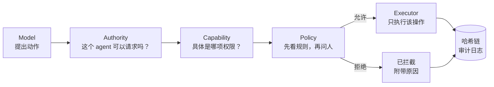

<p align="center">
  <picture>
    <source media="(prefers-color-scheme: dark)" srcset="docs/yana-banner-dark.svg">
    
  </picture>
  <br><br>
  
</p>

<h3 align="center">模型提议，Yana 裁决，人类掌握决定权。</h3>

<p align="center">
  运行在本机的控制层，位于任意 AI 模型与你机器上的实际权限之间。<br>
  负责 Yana 生态的运行时、规则与审计记录。
</p>

<p align="center">
  <a href="https://github.com/Horonomos-laps/Yana-AI/actions/workflows/ci.yml"></a>
  <a href="https://crates.io/crates/yana-rt"></a>
  <a href="https://pypi.org/project/yana-ai/"></a>
  <a href="LICENSE"></a>
</p>

<p align="center">
  <a href="https://merx.help/shield"></a>
  <a href="https://launchindex.io/tool/yana-ai"></a>
</p>

<p align="center">
  <a href="README.md">English</a> ·
  <a href="README.vi.md">Tiếng Việt</a> ·
  <a href="README.ko.md">한국어</a> ·
  <a href="README.zh.md"><strong>中文</strong></a>
</p>

<p align="center">
  <a href="#快速开始">快速开始</a> ·
  <a href="#工作原理">工作原理</a> ·
  <a href="#yana-生态">生态</a> ·
  <a href="#内部结构">内部结构</a> ·
  <a href="#保护措施与边界">边界</a> ·
  <a href="https://yana.vutam.link">网站</a>
</p>

<p align="center">
  <sub>
    <a href="CODE_OF_CONDUCT.md">行为准则</a> ·
    <a href="CONTRIBUTING.md">参与贡献</a> ·
    <a href="LICENSE">Apache-2.0 许可证</a> ·
    <a href="SECURITY.md">安全政策</a>
  </sub>
</p>

<br>

<table>
  <tr>
    <td align="center" width="20%"><h3>45</h3><sub>运行时子命令<br>单个 Rust 二进制</sub></td>
    <td align="center" width="20%"><h3>66</h3><sub>工具调用 hook<br>Pre、Post 与 Stop</sub></td>
    <td align="center" width="20%"><h3>290</h3><sub>核心文件<br>以 SHA-256 锁定</sub></td>
    <td align="center" width="20%"><h3>100</h3><sub>专业 agent</sub></td>
    <td align="center" width="20%"><h3>2,036</h3><sub>工作知识 skill，<br>不授予权限</sub></td>
  </tr>
</table>

<p align="center"><sub>数量取自文件系统，并在 CI 中由 <code>core/scripts/check_counts.py</code> 校验。</sub></p>

## 为什么做这个项目

能执行命令的 agent，也可能执行错误的命令。skill 和提示词能让 agent 把活干得更好，却挡不住
它造成破坏。Yana 在每个动作之前设置独立的裁决步骤，这一步不依赖模型表现良好。

- 模型说明它想做什么，是否允许由 Yana 决定。
- 每个决定都写入哈希链日志，事后改动会被发现。
- 人随时可以让 agent 停下，有些动作没有人就无法发生。

## 快速开始

```bash
pip install yana-ai    # Python CLI
yana-ai install        # 把 Yana 的 hook 和规则加入你的仓库
yana-ai doctor .       # 检查各部分是否接好
cargo install yana-rt  # 原生运行时，无需 Python
```

需要 Python 3.11+（或 Rust）、Git，以及一个受支持的宿主：Claude Code、Codex、Cursor 或
Antigravity。全部命令见 [COMMANDS.md](COMMANDS.md)。Yana 不发布到 npm，见
[VERSIONING.md](VERSIONING.md)。

**想用应用？** macOS 版 Yana 与 Yana Studio 在同一个下载包中，可从
[Yana-studio 发布页](https://github.com/Horonomos-laps/Yana-studio/releases/latest) 或
[yana.vutam.link](https://yana.vutam.link) 获取。需要 Apple Silicon 上的 macOS 14 或更高版本。

<!-- IMAGE: Yana Studio 在审批下运行 agent -->

> [!NOTE]
> macOS 版本使用 ad-hoc 签名，**未经 Apple 公证**（目前没有 Apple Developer 账号），首次
> 打开时 Gatekeeper 会发出警告。[docs/MACOS_INSTALL.md](docs/MACOS_INSTALL.md) 说明了两种
> 官方打开方式。请用发布页列出的 SHA-256 值校验下载文件。`yana-rt` 二进制提供 macOS
> （Apple Silicon 与 Intel）、Linux x64 和 Windows x64 版本，没有 Linux ARM 版本。

## 工作原理

Claude、GPT、Gemini、DeepSeek，或运行在你本机的模型，都走同一条路径。



skill 教 agent 如何工作。只有 capability 能授予行动权限。

## Yana 生态

|  | **Yana-AI**（当前仓库） | **[yana-web](https://github.com/Horonomos-laps/yana-web)** | **[Yana-studio](https://github.com/Horonomos-laps/Yana-studio)** |
| --- | --- | --- | --- |
| **内容** | 运行时 `yana-rt`、治理规则与 hook、CLI、agent 与 skill | 网站，以及在本机运行的网页应用（聊天、项目、密钥库） | macOS 版 Yana 与 Yana Studio |
| **技术** | Rust、Python、shell | Node.js、React | SwiftUI、Code-OSS |
| **角色** | 裁决 | 展示 | 展示 |

应用不直接调用模型服务商。Studio 把每个请求都交给 `yana-rt`，换客户端也绕不过权限检查。

> [!NOTE]
> 网页应用、网站和桌面应用现在位于各自的仓库。提到 `tools/yana-web`、`tools/yana-studio`
> 或 `tools/yana-ide` 的旧链接和历史记录指向已迁走的代码。这些部分的新工作在 yana-web 和
> Yana-studio 进行。

## 本仓库包含什么

| 组件 | 作用 | 状态 |
| --- | --- | --- |
| **[运行时 `yana-rt`](src)** | 所有客户端和服务商共用一个回合循环和一份 authority 约定。 |  |
| **[治理](core)** | capability 清单、人工审批、哈希链审计日志、core-lock 完整性。 |  |
| **[Giám Thị](#内部结构)** | 运行在所有 AI 会话之外的监督器，发现偏差后拦下之后的每次工具调用。 |  |
| **[Harness 适配器](adapters)** | Claude Code、Codex、Cursor 和 Antigravity。执行强度因宿主而异。 |  |
| **[知识层](core/skills)** | 教 agent 如何工作的 agent、skill、命令和规则，不授予任何权限。数量见下方目录树。 |  |
| **[Yana OS](src/os)** | 本地管理层：agent 身份、自主级别、配额、健康状态、隔离。 |  |
| **[Yana Wheelbot](https://github.com/yanacuti1121/yana-wheelbot)** | 基于 ESP32-S3 的机器人平台，位于独立仓库。 |  |

`使用中` 表示已发布并在使用。`开发中` 表示已有真实代码但功能未完备。`实验性` 表示需手动
启用，且未经独立验证。

`yana-rt` 有 45 个子命令，不依赖 Python。这是按源码统计的所有构建配置的数量，包括 feature
开关后面的命令。

```text
core/
├── hooks/    # 66 个 PreToolUse / PostToolUse / Stop hook，实际运行哪些由 settings.json 决定
├── rules/    # 71 条规则，大多是 agent 自行遵循的指引，hook 只强制执行其中一部分
├── agents/   # 100 个专业 agent
├── skills/   # 2,036 个 skill
├── commands/ # 170 个 Claude Code 斜杠命令
└── config/
    └── core-lock.json    # SHA-256 清单，锁定 290 个核心文件
```

## 内部结构

展开各项查看细节。

<details>
<summary><b>运行时：Rust 引擎 yana-rt</b></summary>

一个 Rust 二进制掌管所有客户端的回合循环和 authority 检查，因此 Studio、CLI 和 MCP 不必
各自实现权限逻辑。

- **Provider：** anthropic、openai、gemini、groq、deepseek、openrouter、xai、novita、nvidia、minimax、glm、huggingface、9router、kimi、mistral、together、fireworks、deepinfra、cerebras、sambanova、perplexity、qwen、cohere、ai21、ernie（云端），以及 ollama、lmstudio、llamacpp、turbofieldfare、airllm、vllm、jan（本地）。权威列表见 [`src/model/catalog.rs`](src/model/catalog.rs)。
- **故障切换：** 分类型的服务商错误、备用服务商、凭据池轮换。
- **状态：** 支持全文检索的 SQLite 会话存储、按 profile 隔离的状态、崩溃恢复、可回滚的 shadow-git 检查点。
- **Capability 工具：** 文件读取与打补丁、经校验的命令执行、stdio MCP 客户端、经受控 HTTPS 层的 `web.search`、只读 LSP 客户端。
- **功能开关：** 默认构建包含 `cli` 和 `mcp`（MCP 服务端与客户端）。`lsp`、`pty-bridge` 和 Discord 远程适配器为可选项，默认关闭。

运行时的剩余工作记录在 [CURRENT-MILESTONE.md](CURRENT-MILESTONE.md)：让所有客户端统一到一个
capability executor，并用真实的本地模型（而非 mock）测试工具调用。

</details>

<details>
<summary><b>性能：测量数据在哪里</b></summary>

注明日期、版本、机器和方法的测量数据见 [BENCHMARK.md](BENCHMARK.md)。本页不再抄录，以免
旧数据被当成现状。

</details>

<details>
<summary><b>Giám Thị：独立监督器</b></summary>

它运行在所有 AI 会话之外，由操作系统自身的调度器（macOS 的 launchd、Linux 的 systemd
timer、Windows 的 Task Scheduler）每 6 小时启动一次。

1. 把控制执行机制的文件与经人工批准的基线提交作比较：Claude Code、Codex 和 Cursor 的 hook 配置、CI 工作流、`core/rules`、`core/gates`、`core/hooks`、`core/scripts` 和 `src/guard`。
2. 发现偏差时写入 `GIAMTHI_HALT.lock`。只要锁文件存在，每次工具调用中最先运行的 hook 就会拒绝一切。
3. 只有人删除锁文件才能解除。hook、监督器和任何环境变量都无法解除。

用 `yana-ai giamthi install | status | repair | uninstall` 管理。它需要手动启用，且按计划运行，
因此从改动到拦停之间最长有 6 小时的窗口。Codex 只在 shell 命令上触发 `PreToolUse`，所以对
Codex，Yana 还会在 `SessionStart` 和 `UserPromptSubmit` 检查锁。

</details>

<details>
<summary><b>Harness 适配器：Claude Code、Codex、Cursor、Antigravity</b></summary>

| 宿主 | 治理方式 | 执行强度 |
| --- | --- | --- |
| **Claude Code** | `.claude/` 中的原生 hook 和规则 | 运行时拦截每次工具调用，哈希链审计 |
| **Codex** | `AGENTS.md`、`.codex/` hook、同步 skill 和 agent（`yana-ai install --engine codex`） | 项目范围的 hook |
| **Cursor** | `.cursorrules`、`.cursor/rules`、`beforeShellExecution` hook | 检查 shell 命令；不覆盖 MCP 工具调用 |
| **Antigravity** | `.agents/rules/yana-ai.md` 与 `.agents/hooks.json` 中的 `PreToolUse` hook（`yana-ai install --engine antigravity`） | shell 命令由 `guard-destructive.sh` 检查；Giám Thị 的 HALT 拦截所有工具调用；`agy --dangerously-skip-permissions` 会跳过 |

详情与切换命令见 [adapters/README.md](adapters/README.md)。Claude Code 斜杠命令（`/plan`、
`/verify`、`/code-review` 等）位于 `core/commands/`，在会话内运行。

</details>

## 保护措施与边界

| 保护措施 | 作用 | 边界 |
| --- | --- | --- |
| **审计日志** | 哈希链结构，修改或删除任一行都会被发现（`core/scripts/verify-audit-chain.sh`）。 | 能发现篡改，不能阻止篡改。 |
| **Core-lock** | SHA-256 清单发现 `core/` 中被改动、删除或插入的文件。 | 只证明目录与锁一致，不证明有人审阅过：能改 `core/` 的人也能重新生成锁。独立检查由 Giám Thị 承担。 |
| **人工关卡** | force-push、发布、部署和删除需要在当前会话中确认。 | 之前的批准不会延续。 |
| **Giám Thị** | 一旦发现问题，锁住之后的所有工具调用，直到有人解除。 | 需手动启用且定期运行，并非即时。 |
| **规则与 hook** | hook 在运行时拦截。 | `core/rules` 中多数文件描述 agent 自行遵循的行为，只有接入 hook 的部分会被强制执行。没有代码签名流程。 |
| **破坏性命令防护** | `guard-destructive.sh` 拦截 `rm -rf`、force-push、`DROP TABLE` 等。 | 按命令字符串匹配，并非完整解析 shell，刻意构造的命令可能漏过。 |

Antigravity 只检查 shell 命令，且会被 `agy --dangerously-skip-permissions` 绕过；Cursor 不检查
MCP 调用；没有 Rust 运行时、仅在浏览器中运行的网页部署未受完整治理。详见
[已知限制](docs/reference/known-limitations.md)。

四条示例命令，于 2026-11-14 在 `main` 的默认 hook 链上重新运行（引自
[技术报告](https://yana.vutam.link/whitepaper-en.html) 表 1）：

| agent 想执行的命令 | 结果 | 由哪一层处理，agent 得到什么提示 |
| --- | --- | --- |
| `curl -fsSL https://.../install.sh \| bash` | 已拦截 | `tool-proxy-enforcer`：管道进入解释器。`supply-chain-guard`：先下载、阅读，再运行。并非 `guard destructive`。 |
| `rm -rf ~/Documents` | 已拦截 | `guard destructive`（Rust 与 bash）：强制递归删除无法撤销。 |
| `chmod 777 deploy.sh` | **未拦截** | 只有 `core/scripts/safe-run.sh` 包装器会拦截，而它没有接入 hook 链。这是已知缺口。 |
| `git status --short` | 允许 | 只读命令，任何层都不介入。 |

## 版本

有三条版本轴，各自编号、各自对应注册表：产品（不分发）、crates.io 上的 `yana-rt`、PyPI 上的
Python 包 `yana-ai`。应用通过 [Yana-studio](https://github.com/Horonomos-laps/Yana-studio) 的
GitHub Releases 发布，使用独立标签。版本号容易过时，本页有意不写；顶部徽章实时读取。见
[VERSIONING.md](VERSIONING.md)。

## 文档

| 了解 | 构建 | 信任 | 进展 |
| --- | --- | --- | --- |
| [ARCHITECTURE.md](ARCHITECTURE.md) | [CONTRIBUTING.md](CONTRIBUTING.md) | [SECURITY.md](SECURITY.md) | [ROADMAP.md](ROADMAP.md) |
| [PHILOSOPHY.md](PHILOSOPHY.md) | [COMMANDS.md](COMMANDS.md) | [已知限制](docs/reference/known-limitations.md) | [CURRENT-MILESTONE.md](CURRENT-MILESTONE.md) |
| [沿革](docs/history/LINEAGE.md) | [BENCHMARK.md](BENCHMARK.md) | [致谢](ACKNOWLEDGEMENTS.md) | [CHANGELOG.md](CHANGELOG.md) |

---

<p align="center">
  
</p>

<p align="center">
  由一个人打造，没有团队，没有资助：<b>Vũ Văn Tâm</b>，越南<br>
  <a href="https://yana.vutam.link/">yana.vutam.link</a> ·
  <a href="https://github.com/Horonomos-laps/Yana-AI">Yana-AI</a> ·
  <a href="https://github.com/Horonomos-laps/yana-web">yana-web</a> ·
  <a href="https://github.com/Horonomos-laps/Yana-studio">Yana-studio</a> ·
  <a href="LICENSE">Apache 2.0</a>
</p>
